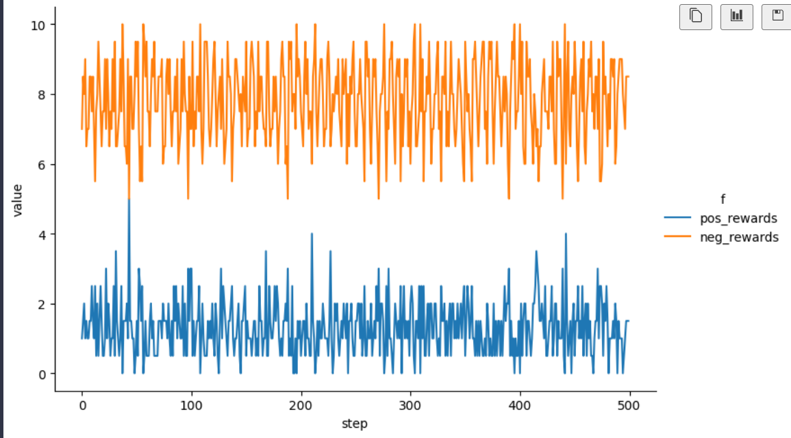

# Disco RL applied to continuous action spaces

### Introduction
The current Disco RL methodology is focussed on discrete action spaces. Presented below are some small tweaks in an attempt to apply this to continuous action spaces.

### Diff

1. $\pi$, $\hat{\pi}$, $p$, $\hat{p}$ sets of samples from their respective networks (e.g. $[-1,1]$ in continuous Catch). $\hat{\pi}$ comes from the meta-network; $\hat{p}$ comes from the agent's policy at the next observed state.

2. $z_{\theta}(s,a)$, $q_{\theta}(s,a)$, $p_{\theta}(s,a)$ now accept a continuous action argument $a$. The $y$ and $z$ outputs remain categorical latent predictions, and $q$ retains categorical return bins. Their categorical losses and the categorical entropy of $y$ and $z$ remain unchanged.

3. Bounded Gaussian KDE is used for policy density estimates. Write $\tilde{\pi}_{\theta}$ for the current policy's estimated density and $\tilde{\mu}$ for the behaviour policy's estimated density. Density usage is highlighted in magenta:

* Advantage actor-critic gradient: 

$$\nabla_{\theta_k}J(\theta_k) \approx E\left[\sum_t \gamma^t \hat{A}_t \nabla_{\theta_k}\log\tilde{\pi}_{\theta_k}(a_t\mid s_t)\right]$$

* Policy differential entropy estimate:

$$\hat{H}(\pi_{\theta}(\cdot\mid s)) = -\frac{1}{N}\sum_{i=1}^{N}\log\tilde{\pi}_{\theta}(a_i\mid s), \qquad a_i\sim\pi_{\theta}(\cdot\mid s)$$

* V-trace and RETRACE density ratio : 

$$\rho_t=\frac{\tilde{\pi}_{\theta}(a_t\mid s_t)}{\tilde{\mu}(a_t\mid s_t)}$$

4. Policy matching and auxiliary next-policy matching now use a smooth approximation to empirical Wasserstein-1:
$$D_{W_{\tau}}(a_{1:N},b_{1:N})=\frac{1}{N}\sum_{i=1}^{N}\left[\sqrt{(a_{(i)}-b_{(i)})^2+\tau^2}-\tau\right], \qquad \tau>0$$
Here $a_{(i)}$ and $b_{(i)}$ are independently sorted samples.
$$L_{\pi}=D_{W_{\tau}}(\pi,\hat{\pi}), \qquad L_p=D_{W_{\tau}}(p,(\hat{p}))$$

Also $L_{\mathrm{KL}}=D_{\mathrm{KL}}(\pi_{\theta^-}\Vert\hat{\pi})$ in meta-optimisation stabilisation becomes
$$L_W=D_{W_{\tau}}(\pi_{\theta^-},\hat{\pi})$$

5. Numerical actions are normalised and passed through a trainable linear layer:
$$a_{\mathrm{norm}}=2\frac{a-a_{\min}}{a_{\max}-a_{\min}}-1, \qquad e_a=W_a a_{\mathrm{norm}}+b_a\in\mathbb{R}^{16}$$

### Results

